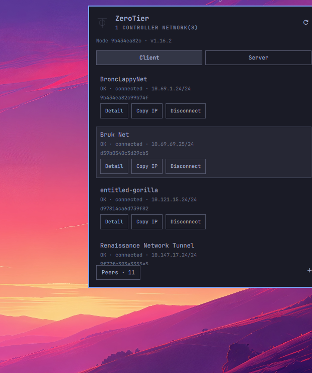

# ZeroTier for Omarchy

ZeroTier client and controller admin from the [Omarchy](https://omarchy.org/) bar.

Unofficial third-party widget — not affiliated with ZeroTier, Inc.



## Features

**Client**
- Join / leave networks; connect / disconnect managed config from list
- Network detail toggles (DNS, default route, global, managed)
- Peers list
- Full keyboard navigation (j/k, arrows, enter, esc)

**Controller** (when this node runs a controller)
- List, create, edit, and delete networks
- Member list: authorize, edit name/flags/IPs, remove
- Flow rules editor (ZeroTier RDL or JSON)
- IP pools, routes, DNS, MTU, and assignment flags

**General**
- API token in **OS keyring** (libsecret; compatible with [ztnui](https://github.com/brukberhane/ztnui) keyring entry)
- Configurable refresh interval

Roadmap: [docs/intended_features.md](docs/intended_features.md)

## Requirements

- `zerotier-one` running locally
- `curl`, `python3`, `secret-tool` (libsecret / GNOME Keyring)
- `wl-copy` for copy actions
- `node` on PATH (compiles RDL flow rules when creating/editing controller networks)

## Install

From a git checkout:

```bash
omarchy plugin add https://github.com/brukberhane/omarchy-zerotier.git --enable
```

Or if the folder is already under `~/.config/omarchy/plugins/`:

```bash
omarchy plugin enable io.github.brukb.omarchy-zerotier right
omarchy restart shell
```

On first open, paste your API token (from `sudo cat /var/lib/zerotier-one/authtoken.secret`). It is saved to the keyring only.

Validate before publishing:

```bash
omarchy plugin validate ~/.config/omarchy/plugins/io.github.brukb.omarchy-zerotier
```

## Backend

No build step. `bin/ztn-api` is bash calling the local [ZeroTier Service API](https://docs.zerotier.com/openapi/service/v1.json) on `127.0.0.1:9993`.

```bash
~/.config/omarchy/plugins/io.github.brukb.omarchy-zerotier/bin/ztn-api auth status
~/.config/omarchy/plugins/io.github.brukb.omarchy-zerotier/bin/ztn-api networks
```

## Settings

```bash
omarchy bar set io.github.brukb.omarchy-zerotier refreshIntervalSec 30
```

## Removal

```bash
omarchy plugin disable io.github.brukb.omarchy-zerotier   # remove from the bar
omarchy plugin remove io.github.brukb.omarchy-zerotier     # delete the plugin
```

To clear the stored API token from the OS keyring before removal:

```bash
~/.config/omarchy/plugins/io.github.brukb.omarchy-zerotier/bin/ztn-api auth clear
```

`zerotier-one` and any joined networks are untouched.

## License

MIT — see [LICENSE](LICENSE).
